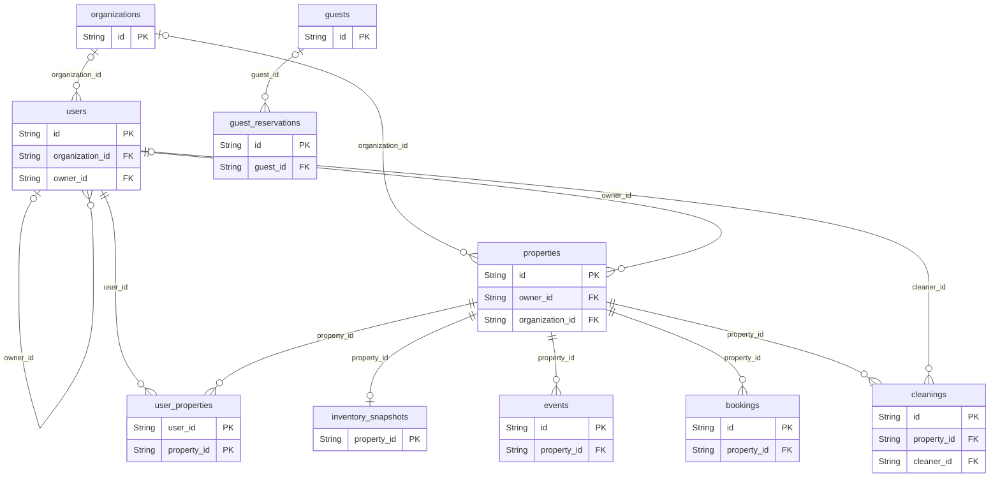
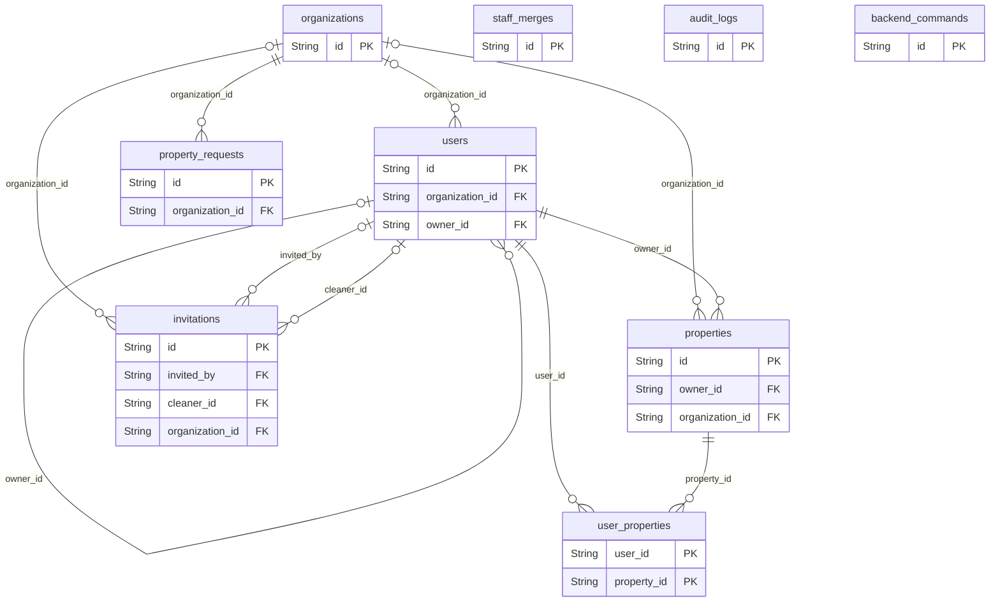
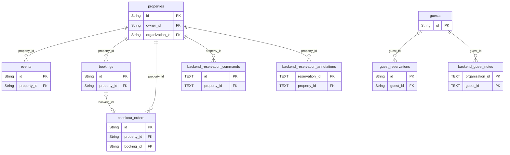
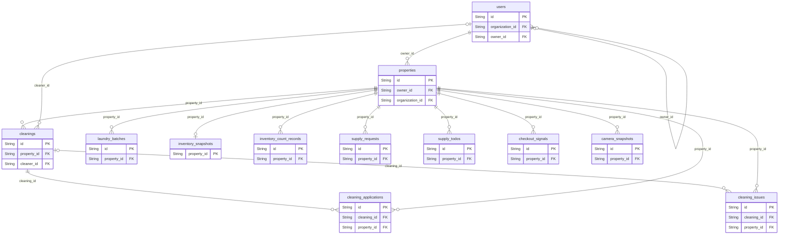
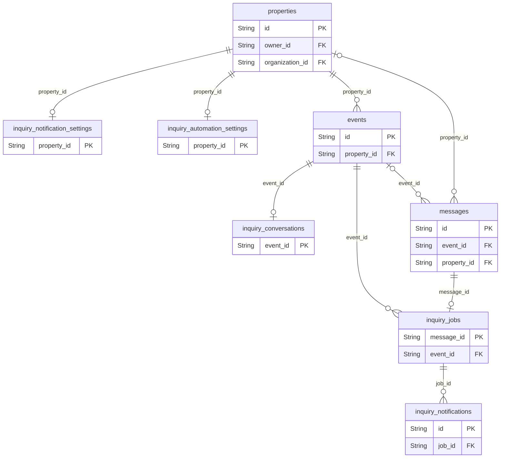
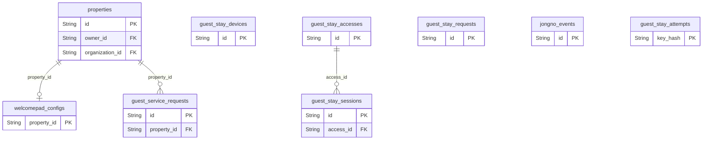
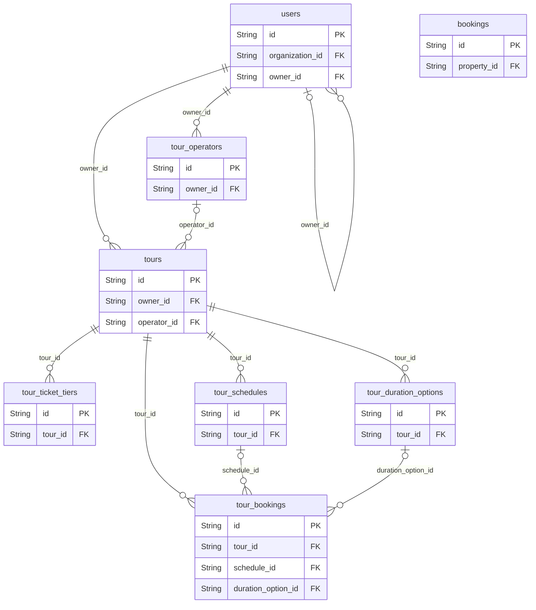
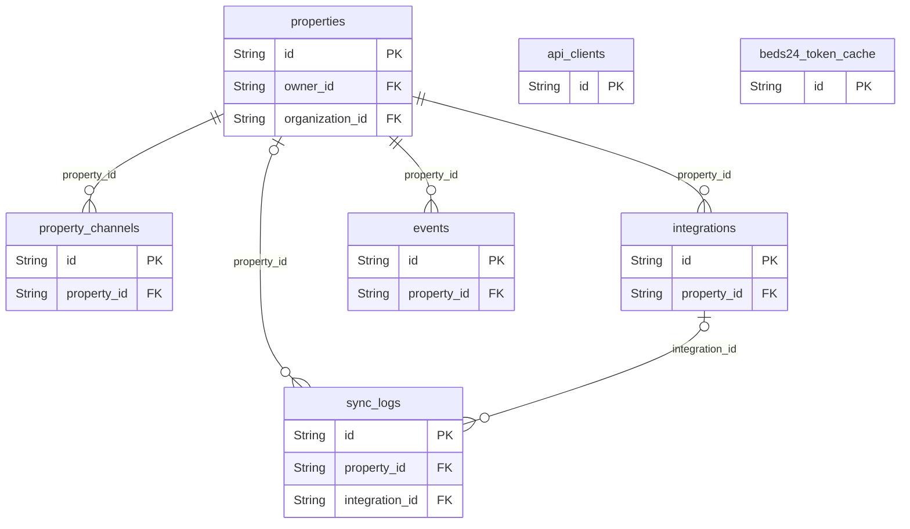
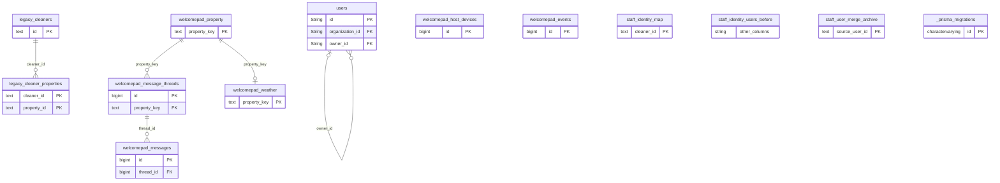
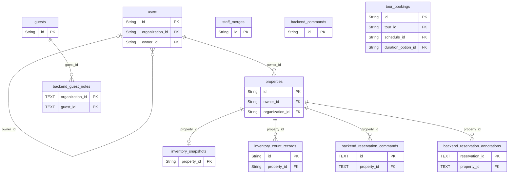

# Hosting Manager 현재 ERD

2026-10-05 · 소스와 연결 DB의 읽기 전용 메타데이터를 대조했습니다. 실제 업무 데이터 행은 포함하지 않습니다.

- Prisma 모델 49개 + SQL 전용 테이블 3개 = 코드 정의 52개
- 연결 DB public 테이블 57개, FK 54개
- 코드에 있지만 DB에 없는 테이블 7개, DB에만 있는 테이블 12개
- 합집합 64개를 HTML의 전체 테이블 검색에서 확인할 수 있습니다.
- [인터랙티브 관계도](current-erd.html): 업무별 보기, 확대, 논리 관계 켜기/끄기, 전체 컬럼 확인

## DB 적용 차이

| 항목 | 현재 상태 |
| --- | --- |
| `staff_merges` | 테이블 없음 |
| `inventory_snapshots` | 테이블 없음 |
| `inventory_count_records` | 테이블 없음 |
| `backend_commands` | 테이블 없음 |
| `backend_reservation_commands` | 테이블 없음 |
| `backend_guest_notes` | 테이블 없음 |
| `backend_reservation_annotations` | 테이블 없음 |
| `tour_bookings.requested_date` / `requested_time` | 컬럼 없음 |
| `tour_bookings.schedule_id` | 소스는 선택값, DB는 NOT NULL |

FK 선은 소스 선언 관계입니다. 미적용 테이블의 관계도 포함하므로 운영 적용 상태와 혼동하지 마세요. 논리 관계는 FK로 표시하지 않으며 각 그룹의 별도 목록에 적습니다. Mermaid에서 부모 쪽 `o|`는 선택 참조, 자식 쪽 `o{`는 0~N개, `o|`는 0~1개입니다.

## 핵심 관계

사업자를 중심으로 계정과 숙소를 나누고, 숙소에 예약·청소·재고가 연결됩니다. Event와 Booking은 같은 예약을 나타낼 수 있지만 직접 외래키로 연결돼 있지 않습니다.

논리 연결(FK 없음):

- `guest_reservations.property_id` → `properties`

## 사업자·권한

organization_id는 사업자 소속, user_properties는 실제 숙소 배정입니다. 감사·병합 이력은 과거 식별자를 남기기 위해 일부 관계를 논리적으로만 연결합니다.

논리 연결(FK 없음):

- `backend_commands.actor_id` → `users`
- `backend_commands.organization_id` → `organizations`
- `audit_logs.actor_id` → `users`
- `audit_logs.organization_id` → `organizations`
- `audit_logs.property_id` → `properties`
- `staff_merges.source_user_id / target_user_id` → `users`
- `property_requests.property_id` → `properties`

## 예약·고객

events는 채널 동기화, bookings는 직접 예약, guest_reservations는 삭제와 무관하게 남기는 고객 투숙 이력입니다. 새 예약 메모·명령·고객 메모 테이블은 아직 DB에 없습니다.

논리 연결(FK 없음):

- `guest_reservations.property_id` → `properties`

## 청소·재고·세탁

청소 정산은 청소 완료 기록을 조회해 계산합니다. 별도 정산 테이블은 없습니다. 세탁의 items/history와 재고의 items는 JSON이며 별도의 품목 테이블로 정규화돼 있지 않습니다.

논리 연결(FK 없음):

- `inventory_count_records.checked_by_id` → `users`
- `laundry_batches.created_by` → `users`

## 메시지·자동응답

고객 메시지 → 자동응답 작업 → 담당자 알림으로 이어집니다. 설정은 숙소별 1:1, 대화 상태는 Event별 1:1입니다.

논리 연결(FK 없음):

- `inquiry_jobs.property_id` → `properties`

## 게스트·객실 패드

고정 QR의 숙소, 예약별 접근 권한, 개별 휴대폰 세션은 분리돼 있습니다. reservation_kind + reservation_id는 Event/Booking 중 하나를 가리키는 논리 참조입니다. 종로 행사는 숙박 달력 Event와 별개입니다.

논리 연결(FK 없음):

- `guest_stay_accesses.property_id` → `properties`
- `guest_stay_accesses.device_id` → `guest_stay_devices`
- `guest_stay_devices.property_id` → `properties`
- `guest_stay_requests.property_id` → `properties`

## 투어

투어 상품에 가격 옵션·일정·예약이 연결됩니다. 현재 DB는 requested_date/requested_time 컬럼이 없고 schedule_id를 필수로 요구해, 시간표 없이 받는 문의 예약과 차이가 있습니다.

논리 연결(FK 없음):

- `tour_bookings.booking_id` → `bookings`

## 채널·연동

PropertyChannel은 판매 채널, Integration은 동기화 설정입니다. Beds24 토큰 캐시는 독립 테이블입니다. API 고객의 property_ids는 배열이므로 별도 FK 배정 테이블은 아닙니다.

논리 연결(FK 없음):

- `events.channel_id` → `property_channels`

## DB 전용·이관 기록

Prisma 밖의 테이블입니다. 웰컴패드의 별도 구조, 직원 이관·백업 테이블, migration 이력을 포함합니다. 현재 앱에서 안 보인다는 이유만으로 삭제하면 안 됩니다. 실제 DB에서 확인한 FK만 그립니다.

## DB와 다른 부분

테이블 7개와 tour_bookings의 컬럼 2개·선택값 조건이 소스와 다릅니다. 기존 migration 이력을 확인한 뒤 필요한 변경만 검증 DB부터 적용해야 합니다.

논리 연결(FK 없음):

- `backend_commands.actor_id` → `users`
- `backend_reservation_commands.actor_id` → `users`
- `staff_merges.source_user_id / target_user_id` → `users`
- `inventory_count_records.checked_by_id` → `users`

## 모델·테이블 목록

| 모델 | DB 테이블 | 선언 | 현재 DB |
| --- | --- | --- | --- |
| JongnoEvent | `jongno_events` | Prisma | DB 확인 |
| GuestStayAccess | `guest_stay_accesses` | Prisma | DB 확인 |
| GuestStaySession | `guest_stay_sessions` | Prisma | DB 확인 |
| GuestStayRequest | `guest_stay_requests` | Prisma | DB 확인 |
| GuestStayAttempt | `guest_stay_attempts` | Prisma | DB 확인 |
| GuestStayDevice | `guest_stay_devices` | Prisma | DB 확인 |
| User | `users` | Prisma | DB 확인 |
| StaffMerge | `staff_merges` | Prisma | 미적용 |
| UserProperty | `user_properties` | Prisma | DB 확인 |
| Property | `properties` | Prisma | DB 확인 |
| Organization | `organizations` | Prisma | DB 확인 |
| AuditLog | `audit_logs` | Prisma | DB 확인 |
| PropertyRequest | `property_requests` | Prisma | DB 확인 |
| InquiryNotificationSettings | `inquiry_notification_settings` | Prisma | DB 확인 |
| InquiryAutomationSettings | `inquiry_automation_settings` | Prisma | DB 확인 |
| InquiryConversation | `inquiry_conversations` | Prisma | DB 확인 |
| InquiryJob | `inquiry_jobs` | Prisma | DB 확인 |
| InquiryNotification | `inquiry_notifications` | Prisma | DB 확인 |
| LaundryBatch | `laundry_batches` | Prisma | DB 확인 |
| InventorySnapshot | `inventory_snapshots` | Prisma | 미적용 |
| InventoryCountRecord | `inventory_count_records` | Prisma | 미적용 |
| ApiClient | `api_clients` | Prisma | DB 확인 |
| WelcomepadConfig | `welcomepad_configs` | Prisma | DB 확인 |
| PropertyChannel | `property_channels` | Prisma | DB 확인 |
| Integration | `integrations` | Prisma | DB 확인 |
| Event | `events` | Prisma | DB 확인 |
| Booking | `bookings` | Prisma | DB 확인 |
| CheckoutOrder | `checkout_orders` | Prisma | DB 확인 |
| Guest | `guests` | Prisma | DB 확인 |
| GuestReservation | `guest_reservations` | Prisma | DB 확인 |
| CheckoutSignal | `checkout_signals` | Prisma | DB 확인 |
| CameraSnapshot | `camera_snapshots` | Prisma | DB 확인 |
| Cleaning | `cleanings` | Prisma | DB 확인 |
| CleaningApplication | `cleaning_applications` | Prisma | DB 확인 |
| CleaningIssue | `cleaning_issues` | Prisma | DB 확인 |
| Message | `messages` | Prisma | DB 확인 |
| SupplyRequest | `supply_requests` | Prisma | DB 확인 |
| SupplyTodo | `supply_todos` | Prisma | DB 확인 |
| Invitation | `invitations` | Prisma | DB 확인 |
| SyncLog | `sync_logs` | Prisma | DB 확인 |
| TourOperator | `tour_operators` | Prisma | DB 확인 |
| Tour | `tours` | Prisma | DB 확인 |
| TourTicketTier | `tour_ticket_tiers` | Prisma | DB 확인 |
| TourDurationOption | `tour_duration_options` | Prisma | DB 확인 |
| TourSchedule | `tour_schedules` | Prisma | DB 확인 |
| TourBooking | `tour_bookings` | Prisma | 컬럼 차이 |
| Beds24TokenCache | `beds24_token_cache` | Prisma | DB 확인 |
| GuestServiceRequest | `guest_service_requests` | Prisma | DB 확인 |
| BackendCommand | `backend_commands` | Prisma | 미적용 |
| BackendReservationCommand | `backend_reservation_commands` | SQL | 미적용 |
| BackendGuestNote | `backend_guest_notes` | SQL | 미적용 |
| BackendReservationAnnotation | `backend_reservation_annotations` | SQL | 미적용 |
| _prisma_migrations | `_prisma_migrations` | DB only | DB 전용 |
| legacy_cleaner_properties | `legacy_cleaner_properties` | DB only | DB 전용 |
| legacy_cleaners | `legacy_cleaners` | DB only | DB 전용 |
| staff_identity_map | `staff_identity_map` | DB only | DB 전용 |
| staff_identity_users_before | `staff_identity_users_before` | DB only | DB 전용 |
| staff_user_merge_archive | `staff_user_merge_archive` | DB only | DB 전용 |
| welcomepad_events | `welcomepad_events` | DB only | DB 전용 |
| welcomepad_host_devices | `welcomepad_host_devices` | DB only | DB 전용 |
| welcomepad_message_threads | `welcomepad_message_threads` | DB only | DB 전용 |
| welcomepad_messages | `welcomepad_messages` | DB only | DB 전용 |
| welcomepad_property | `welcomepad_property` | DB only | DB 전용 |
| welcomepad_weather | `welcomepad_weather` | DB only | DB 전용 |

## 해석 시 주의

- 예약은 Event와 Booking 두 표현을 가지며 Beds24 예약 번호로 논리 중복을 제거합니다. 같은 날짜라는 이유만으로 두 레코드를 합치지 않습니다.
- GuestReservation은 독립적인 투숙 이력입니다. 예약 행 삭제 후에도 기록을 남깁니다.
- Cleaning은 숙소·날짜로 예약 체크아웃과 연결됩니다. 예약 ID에 대한 FK는 없습니다.
- 재고·세탁의 items와 history, 권한 옵션은 JSON/배열입니다. 현재 별도 품목·기능 테이블은 없습니다.
- 게스트 접근 권한, 예약 메모, 명령의 reservation_id는 Event 또는 Booking 참조여서 단일 FK가 아닙니다.
- DB 전용 웰컴패드/직원 이관 테이블은 사용처·보존 목적 확인 전 삭제 대상이 아닙니다.
- 이 문서는 메타데이터 스냅샷입니다. 소스 또는 DB가 바뀌면 다시 비교해야 합니다.

소스 SHA256 앞 12자리: `cdb41d2b250c`. DB 확인 시각: 2026-10-05T08:23:27.886Z.
