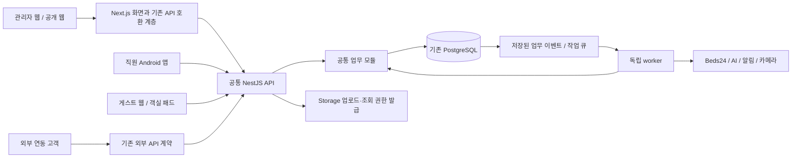

# 호스팅 매니저 공통 백엔드 설계

작성일: 2026-10-05 · 상태: 목표 설계, 일부 구현 완료

구현 진행: 독립 API, 초기 조회와 사업자 관리 공통 서비스를 추가했다. 아래 문서는 전체 목표 설계이며, 현재 제공 범위와 남은 이전 작업은 [구현·실행 문서](backend-implementation.md)를 기준으로 확인한다. 운영 전환은 아직 하지 않았다.

웹 관리자, 직원용 Android 앱, 게스트 웹앱과 객실 패드가 같은 업무 규칙을 사용하도록 백엔드를 분리한다. **NestJS 기반 API와 별도 작업 프로세스(worker)를 두고, 기존 PostgreSQL과 사용자·숙소·예약 ID는 유지한다.** 기능은 한 코드베이스의 모듈로 나누며 API와 worker는 필요한 모듈을 함께 사용한다.

이 문서는 현재 체크아웃의 코드를 읽어 작성했다. 운영 서버·DB 적용 상태를 검증한 배포 보고서가 아니다. 설계 작업에서는 실행 코드, 운영 데이터, 예약 발송 설정을 변경하지 않는다. 구체적인 요청·응답 규칙은 [API 계약 초안](backend-api-contract.md)을 따른다.

## 1. 사용자 요구와 설계 선택

| 구분 | 내용 |
| --- | --- |
| 사용자 요구 | 웹과 Android에서 동일 업무 처리, 오늘·캘린더 속도 개선, 사업자별 숙소·사용자 격리, 기능별 권한, 웹에서 활동 기록 확인 |
| 유지할 운영 규칙 | 슈퍼매니저의 사업자·옵션·지점 승인, 사업자 관리자의 자기 사업자 관리, 매니저의 배정 숙소·메뉴 권한, 청소 담당자의 현장 업무 |
| 권장 설계 | 하나의 모듈형 백엔드, 독립 실행하는 API와 worker, 기존 DB 유지, REST/OpenAPI 계약, 기능별 단계적 이전 |
| 미정 | 배포 업체·요금제·가용성 수준, 운영 리전 확인, 세션 만료 기간, 데이터 보존 기간, 실제 부하 기준 |

Android는 공통 API를 호출할 수 있으면 된다. 처음부터 도메인별 서버나 DB를 여러 개 만들 필요는 없다. NestJS 모듈은 관련 기능과 공개 인터페이스를 묶는 데 사용한다. [NestJS 모듈 공식 문서](https://docs.nestjs.com/modules)

## 2. 현재 코드에서 확인한 출발점

| 영역 | 현재 상태와 설계에 미치는 영향 |
| --- | --- |
| 웹/API | `app/api`의 Next.js handler가 업무 서비스를 호출한다. `next.config.ts`의 standalone 출력은 실행 패키징이며 공통 API 분리가 완료됐다는 뜻은 아니다. |
| 배포 작업 | `netlify/functions`에 cron/background가 이미 있다. Beds24 sync·camera는 공유 job을 직접 실행하고 messages·payments에는 Next API 호출 경로가 남아 있다. |
| DB | `lib/prisma.ts`의 PostgreSQL pool은 프로세스당 최대 3개, idle 10초, 연결 대기 5초다. 현재 기본 접속은 transaction pooler다. |
| 인증 | `lib/auth.ts`의 자체 사용자·JWT 쿠키 인증이다. Supabase Auth로의 변경을 이번 이전에 포함하지 않는다. |
| Android | 별도 저장소 `hosting-manager-mobile`에 웹 API를 중계하는 서버가 있다. 앱용 불투명 세션, 암호화된 원본 쿠키, SQLite 상태와 사용자별 polling을 사용한다. 공통 백엔드로 이전할 대상이다. |
| 모바일 검증 | 모바일 README에 실계정·실기기·FCM 검증의 미완료 항목이 있다. 코드 존재를 운영 준비 완료로 간주하지 않는다. |
| API 이름 | 기존 `/api/v1/*`는 `ApiClient`로 인증하는 외부 연동 API다. 직원 로그인 API와 구분해야 한다. |
| 신뢰성 | `InquiryJob`/`InquiryNotification`, 결제 lease, 재고 command ID·version 등은 이미 있다. 범용 outbox·모든 작업 공통 멱등성이 완성된 상태는 아니다. |

현재 모바일 중계 서버는 admin/manager만 허용하고 로그인 때 캘린더·문의함을 함께 읽는다. 새 super_admin/cleaner 역할 및 메뉴가 제한된 계정과의 불일치가 있어 공통 bootstrap으로 수정할 대상이다. 구형 패드의 공유 키 인증과 신형 장치 페어링도 공존하므로 실제 설치된 장치의 교체·키 회수 절차를 포함한다.

6월의 [안정화·서비스 분리 계획](stabilization-and-service-separation-plan.md)은 단계적 분리 방향의 배경 자료로 보존한다. 당시의 코드 위치, 장애 목록, 비용, 구현 상태는 현재 기준으로 다시 판단하며 이 문서의 현황·이전 순서를 우선한다.

## 3. 목표 구성



API는 인증, 범위 검증, 조회, 빠른 업무 변경과 작업 접수를 담당한다. Worker는 동기화, AI 처리, 외부 발송, 결제 결과 재확인처럼 시간이 오래 걸리거나 재시도가 필요한 작업을 담당한다. **업무 변경의 주인은 공통 업무 모듈**이며, API와 worker가 각각 다른 규칙으로 같은 테이블을 수정하지 않는다.

이전 중에는 Next가 아직 옮기지 않은 기능을 계속 처리한다. 이전한 기능은 Next handler가 공통 API에 전달하고, 해당 handler의 직접 DB 변경은 제거한다. 동일 명령을 구·신 서버에서 동시에 실행하지 않는다.

### 저장소 배치 제안

현재 Next 프로젝트의 경로를 한꺼번에 옮기지 않고 다음 구조를 추가한다. 별도 Git 저장소인 모바일·패드·세탁 서비스를 이 저장소 안으로 복사하지 않는다.

```text
hosting-manager/
  app/                         기존 Next 화면과 호환 handler
  services/api/                Nest controller, guard, HTTP 오류 변환
  services/worker/             큐 소비, 스케줄, 종료·복구 처리
  packages/domain/             업무 모듈과 공개 서비스 인터페이스
  packages/contracts/          검증 스키마, DTO, OpenAPI, 생성 클라이언트
  packages/data/               Prisma 연결과 transaction 기반 코드
  prisma/                      유일한 schema/migration 원본 유지
  lib/                         아직 이전하지 않은 코드
```

공통 업무 코드가 Next의 `cookies`, `NextResponse` 또는 route 파일의 타입을 가져오지 않도록 한다. `auth.ts`, `core/http.ts`, `api-auth.ts`, `ops-attention.ts`는 이 경계를 정리할 대상이다. `generated/prisma`는 동일 schema에서 생성하며 API·worker별로 다른 스키마를 두지 않는다.

## 4. 모듈과 데이터 책임

아래의 소유는 DB를 나눈다는 뜻이 아니라, 변경 규칙과 검증을 책임지는 모듈을 뜻한다. 다른 모듈은 해당 모듈의 공개 서비스를 호출한다. 오늘·캘린더는 전용 조회 조합 계층에서 필요한 필드만 읽는다.

| 모듈 | 주요 데이터 | 책임 / 기존 구현 근거 |
| --- | --- | --- |
| Identity & Access | User, UserProperty, Organization, Invitation, StaffMerge | 로그인, 사업자·숙소 범위, 역할·기능, 직원 소속. `auth.ts`, `operational-access.ts`, `operational-permissions.ts` |
| Properties | Property, PropertyRequest, 기능 설정 | 지점 신청·승인·공개, 사업자 이동, 설정 충돌 검사. `operations-settings-store.ts` |
| Reservations | Booking, Event, GuestReservation, Guest | 예약 및 동기화 반영의 일관성, 고객 이력. `beds24-booking.ts`, `sync-engine.ts` |
| Payments | CheckoutOrder | 견적·결제·홀드·확정·환불·결과 재확인. `payments/checkout.ts`; 예약 변경은 Reservations 서비스 사용 |
| Integrations | PropertyChannel, Integration, Beds24TokenCache, SyncLog | 외부 통신, 토큰, 동기화 실행 이력. `beds24.ts`, `jobs/beds24-sync.ts` |
| Housekeeping | Cleaning, CleaningApplication, CleaningIssue | 청소 생성·배정·변경·취소·완료·정산. `cleaning-settlement.ts` 및 현재 route의 업무 로직 |
| Inventory & Supplies | InventorySnapshot, InventoryCountRecord, LaundryBatch, SupplyRequest, SupplyTodo | 실사·세탁·비품 기록. `inventory.ts`, `laundry.ts`; 비품 요청과 달력 할 일의 의미 구분 |
| Messaging | Message, InquiryConversation, InquiryJob, InquiryNotification, AI 설정 | 수집·답장·AI 중지·판단 요청·발송 결과. `inquiry-worker.ts` |
| Guest & Devices | GuestStayAccess/Session/Request/Device/Attempt, WelcomepadConfig, CheckoutSignal, CameraSnapshot, GuestServiceRequest | 예약별 게스트 접근, 장치 연결, 현장 요청·퇴실 증거 |
| Tours & Content | Tour/옵션/일정/예약/운영자, JongnoEvent 및 기존 가이드 | 투어와 콘텐츠, 사진 공개 범위. 게스트 요청 접수를 투어 확정으로 처리하지 않음 |
| Audit & Delivery | AuditLog, 신규 outbox·발송 기록 | 변경 증거, 알림 전달, FCM 연결. 업무 본문·비밀값을 감사 로그에 복제하지 않음 |

`Booking`, `Event`, `GuestReservation`, `CheckoutOrder`는 목적이 다르므로 첫 단계에서 새 예약 테이블 하나로 합치지 않는다. 별도 `laundry-service`의 과금·배송 원장 및 인증 정책도 합치지 않는다. 두 제품의 연결은 추후 명시적인 API 계약으로 다룬다.

## 5. 사업자와 사용자 권한

모든 요청의 권한은 서버에서 **계정 상태 → 사업자 상태 → 역할 → 숙소 배정 → 사업자·숙소 사용 옵션 → 사용자 메뉴 → 대상 작업** 순서로 판단한다. UI에서 메뉴를 감추는 것만으로 권한을 구현하지 않는다.

| 사용자 | 허용 범위 |
| --- | --- |
| 슈퍼매니저 | 사업자 등록·초대·옵션 설정·지점 승인과 사업자 간 관리. 변경 시 대상 사업자를 명시하고 감사 기록을 남긴다. |
| 사업자 관리자 | 자기 사업자의 숙소·직원. 새 지점은 요청하며 다른 사업자 접근·슈퍼 권한 부여는 불가하다. |
| 매니저 | 같은 사업자에 속한 배정 숙소와 배정 메뉴 안의 업무. 직원 관리도 그 범위를 넘지 못한다. |
| 청소 담당자 | 배정/신청 가능한 청소, 자신의 작업·취소·보고와 허용된 재고·세탁·비품 기능. |

기존 `null` 메뉴는 역할 기본값, `[]`는 선택 기능 미허용이라는 차이를 유지한다. 사업자에서 끈 기능을 지점이나 사용자가 되살릴 수 없다. 미소속 계정을 임의 사업자로 자동 귀속하지 않는다. 미소속 관리자와 직원의 이동 조건은 [사업자 설정 문서](business-access-settings.md)를 그대로 적용한다.

클라이언트가 보내는 `organizationId`와 `propertyId`는 요청 대상일 뿐 권한 증거가 아니다. DB에서 대상의 실제 소속을 확인한다. 목록 조회뿐 아니라 상세 ID, 파일, 작업 상태, 변경 이력, 내보내기에도 같은 조건을 적용한다. 외부 `ApiClient.propertyIds=[]`의 기존 ‘전체’ 설정은 별도의 resolver로 현재 허용 지점을 계산하며, 계산 결과 `[]`를 전체 접근으로 해석하지 않는다.

기존 ApiClient에는 사업자 필드가 없으므로 신규 사업자용 키는 이 모델의 무범위 동작으로 발급하지 않는다. 사업자 ID·범위 유형·지점·scope를 명시하는 후속 모델을 정의하고, 기존 키는 실제 소유권을 확인해 이관한다. 또한 사업자 없는 공통 Guest 기록의 전체 예약 횟수·이력을 그대로 노출하지 않고, 접근 가능한 GuestReservation을 통해 고객 범위와 집계를 계산한다. 사업자 간 고객 병합·연락처 공유를 자동 허용하지 않는다.

### 인증 경로 구분

| 경로 | 인증 방식의 설계 |
| --- | --- |
| 직원 웹 | 동일 출처의 HttpOnly·Secure 쿠키, 상태 변경 시 CSRF/Origin 검증. Next 호환 계층이 API로 전달한다. |
| 직원 앱 | 짧은 access token + 회전하는 refresh token. 기기별 서버 세션과 폐기 기능. API는 유효 사용자·사업자·권한을 재검증한다. |
| 게스트 | 기존 예약 링크/확인 코드와 이름 확인, 예약 범위·이용 시간·회수 조건을 유지한다. 직원 토큰을 사용하지 않는다. |
| 객실 패드 | 일회용 연결로 발급한 장치 자격과 숙소 범위. 연결 해제·분실 시 회수한다. 유지보수 명령은 별도 허용 범위를 검사한다. |
| 외부 파트너 | 기존 API 키와 scope·지점 resolver. 앱에 파트너 키나 DB 관리자 키를 내장하지 않는다. |

토큰 형식은 서명된 access JWT와 해시로 저장하는 불투명 refresh token을 우선안으로 한다. issuer/audience/algorithm을 명시하고 원본 refresh token을 DB·로그에 저장하지 않는다. 새 기기 세션은 기존 User와 비밀번호 해시를 사용한다. 로그아웃·계정 중지·비밀번호 변경 시 세션을 폐기하며 회수 여부를 서버에서 확인한다. 만료 기간은 운영 정책 확정 항목이다.

기존 `va_session`은 전환 기간에만 legacy 검증기로 처리한다. 공유 쿠키를 읽는 Next가 TLS로 원본 자격을 내부 API에 전달하고, backend가 직접 서명·만료·최신 사용자 범위를 확인한다. 사용자 ID나 역할 헤더만 믿지 않는다. 새 인증으로 교환하는 경우 원본 만료를 임의로 연장하지 않는다. 새 `/auth`와 기존 `/api/auth/*` 어댑터, 아직 남은 Next route를 함께 검증한 뒤 기존 검증기를 제거한다.

첫 조회 이전은 기존 인증을 검증하는 호환 계층으로 시작한다. 새 AuthSession과 refresh 회전은 별도 확장 migration 및 양쪽 로그인 호환 검증을 거쳐 도입한다. 청소 공유 링크는 기존 공개 토큰의 사용자·숙소 범위 확인과 회수를 유지한다. 내부 cron 자격은 직원·장치 인증과 섞지 않는다.

새 세션 전까지 Android 조회는 앱 → 기존 모바일 프록시 → 신규 API 순서로 검증한다. 프록시가 보관한 원본 자격을 제한된 legacy 경로로 전달하며 앱의 현재 불투명 토큰을 신규 API가 곧바로 해석한다고 가정하지 않는다. 구형 패드 공유키도 기존 경로의 제한된 adapter에서만 지원한다. 신규 장치·직원 API의 일반 인증으로 받아들이지 않고, 설치 장치의 페어링 전환을 확인한 뒤 회수한다.

## 6. 반드시 유지할 업무 규칙

- 예약 확정은 Beds24 성공 ID 또는 외부 재조회로 실제 생성이 확인된 뒤 처리한다. timeout을 예약 생성 실패로 단정해 다시 생성하지 않는다. 취소 실패 시 로컬만 취소하지 않는다.
- 결제 금액·통화·예약 조건은 접수 시 고정한다. 결제 성공과 숙소 예약 확정은 별도 상태이며, 미확정 결과는 재확인 또는 환불 절차로 연결한다.
- 자동 청소는 유효한 예약의 체크아웃을 기준으로 한다. 입실 안내 발송은 청소 완료·정산 생성과 별도 명령이다. 수동/외부 생성 일정의 출처를 유지한다.
- 청소 담당자 변경은 기존 배정자 취소 안내와 새 담당자 안내의 전달 대상을 변경 시점에 기록한다. 완료·취소·정정 이력을 보존하며 단순 삭제로 추적 정보를 잃지 않는다.
- 정산은 현재 전월 26일~당월 25일 규칙을 공통 서비스로 옮긴다. 담당자 없는 완료는 개인 정산에 임의 포함하지 않는다. 현재 웹 화면에 남은 집계도 같은 서비스를 사용하게 한다.
- 현재 재고는 실사값이다. 미입력 품목은 0이 아니며 세탁 출고·입고가 실사 재고를 자동 증감하지 않는다. 비품 요청은 자유 텍스트, 업체·배송 예정일은 현장 기록의 필수 항목이 아니다.
- Beds24 예약 자동 메시지는 기존 Beds24가 발송한다. `VOID_INVITATION` 링크 준비·갱신과 전송 조건은 분리하며 새 worker가 예약 확인 메시지를 중복 발송하지 않는다.
- AI 답장은 숙소·대화별 중지와 지식 버전을 확인한다. 생성된 초안, 전송 접수, 실제 전달을 구분한다. 직원 응대 여부를 단순 발송 로그만으로 추정하지 않는다.
- 월간 캘린더는 앞뒤 달의 표시 날짜, 기간에 걸친 예약, 보이는 예약의 월 밖 체크아웃 청소를 함께 조회한다. 같은 10월 2일 배정 상태가 9월·10월 화면에서 달라지면 전환 실패다.

현재 관리자 메뉴에서 청소 배정·신청 항목을 숨긴 것과 청소 담당자의 신청·취소 기능 폐지는 다르다. 서버 기능은 실제 사용 경로를 확인해 유지한다.

사업자 이동 후 과거 정산의 귀속은 별도 정책 결정이 필요하다. 권장안은 **수행 당시 사업자·수행자를 정산 이력에 고정하고 현재 숙소 소속과 구분**하는 것이다. 현재 소속만으로 과거 금액을 새 사업자에게 넘기지 않는다. 완료 기록의 사업자·수행자 snapshot과 정정 이력을 추가할 때 과거 값은 증거가 있는 경우만 보완하고 나머지는 확인 대상으로 둔다. 정책 확정과 소속 이동 전후의 합계·열람 범위 검증을 청소 단계의 통과 조건으로 삼는다.

## 7. 변경 명령, 트랜잭션, 작업 큐

로컬 변경은 업무 데이터, 감사 기록, 전달할 이벤트를 **같은 DB 트랜잭션**에 저장한다. 외부 호출 동안 DB 트랜잭션을 열어 두지 않는다. 외부 작업은 의도 저장 → lease 확보 → 외부 호출 → 확인된 결과 반영으로 진행한다.

변경 트랜잭션 안에서도 사용자·사업자·숙소의 권한 버전과 소속을 재검사해 인증 이후 소속 이동과 경합하는 변경을 막는다. Worker는 요청자의 범위 또는 작업별 시스템 권한을 명시적으로 사용하며 외부 실행 직전에 최신 옵션·중지 상태를 확인한다. 이미 결제·발송된 결과의 확인·환불 처리는 계정 비활성화로 유실하지 않도록 별도의 복구 권한과 감사 이력을 둔다.

새 쓰기 API는 `Idempotency-Key`, 고정된 요청 내용, 대상 버전을 사용한다. 같은 키의 다른 내용은 409, 진행 중인 명령은 기존 명령 상태를 반환한다. 업무별 unique 제약과 동시성 검증도 필요하며 키만으로 중복 예약을 해결했다고 보지 않는다. 구체적 처리 순서는 [명령 계약](backend-api-contract.md#5-변경-명령과-재시도)을 따른다.

### 추가할 데이터 개념

아래는 신규 테이블 제안이며 이번 작업에서 migration을 생성하거나 실행하지 않는다.

| 개념 | 주요 내용 |
| --- | --- |
| AuthSession | 사용자·기기·인증 유형, refresh 해시/가족, 만료·폐기·회전 상태 |
| CommandRecord | 명령 ID, actor·대상 사업자·숙소, 요청 hash, 상태, 결과 참조, 오류 분류 |
| OutboxEvent | 이벤트 ID·종류·대상·업무 버전·schemaVersion, 발생 시각, 전달 상태 |
| DeliveryAttempt / DeviceRegistration | 이벤트·수신자·채널의 중복 방지, provider ID, 접수/전달/불명 상태, 사용자별 기기 등록 |
| ExecutionOwnership | 이전 단위별 실행 주체(legacy/backend), 전환 세대, 작업 lease·만료 |

`InquiryJob`, `InquiryNotification`, `CheckoutOrder`, 재고의 요청 기록은 기존 상태를 먼저 보존한다. 새 큐는 이 작업을 깨우는 실행 도구이며 기존 상태를 초기화하거나 별도 성공 상태로 덮어쓰지 않는다. 범용 CommandRecord는 원 업무 기록을 참조하고 같은 결과를 독립적으로 두 군데 수정하지 않는다.

큐는 추가 Redis 없이 사용할 수 있는 **pg-boss를 우선 검증**한다. 업무 트랜잭션에는 outbox까지만 기록하고 dispatcher가 큐로 전달한다. 큐 전송 직후 중단되어 같은 이벤트가 다시 들어와도 consumer가 이벤트 ID·업무 상태로 중복 실행을 막는다. 큐의 잠금 보장이 외부 예약·메시지의 정확히 한 번 처리를 보장하지는 않는다. [pg-boss 공식 저장소](https://github.com/timgit/pg-boss)

### 작업별 처리 단위

| 작업 | 실행 단위 | 재시도 기준 |
| --- | --- | --- |
| 예약/iCal 동기화 | 채널 계정·숙소 | 지점별 격리, 공급자 제한·토큰 공유 고려. 실패한 조회를 예약 삭제로 취급하지 않음 |
| 메시지 수집 | 계정·숙소·수집 위치 | 완전한 수집 확인 뒤에만 진행 위치 갱신 |
| AI 응답 | 수신 메시지·대화 | 기존 lease, 중지 상태, 지식 버전, 더 최근 답장 재검사 |
| 외부 발송 | 이벤트·수신자·채널 | 확실한 미접수만 정책에 따라 재시도. 결과 불명은 확인 대상으로 분리 |
| 결제/예약 확인 | CheckoutOrder 또는 명령 | 외부 결과 조회 후 상태 전이, 무조건 재결제·재예약 금지 |
| 카메라 | 원본 메일/첨부 식별자 | 중복 이미지·판정 방지, 타 지점 실패 격리 |

스케줄은 기존 간격을 기준으로 옮기고 같은 계정/숙소 작업의 활성 소유자는 하나만 둔다. 기존 cron과 신규 worker 모두 공통 ownership/lease를 확인하도록 만든 뒤 전환한다. 이미 실행 중인 legacy 작업을 끝내거나 확인 상태로 남긴 후 소유권을 넘긴다. 장시간 작업은 lease 갱신과 전환 세대를 검사하며, 만료만으로 외부 발송을 재실행하지 않는다.

현재 Beds24 토큰 갱신·credit 관측의 프로세스 메모리 상태는 여러 API/worker에서 공유되지 않는다. 공급자 계정별 갱신 lease와 공통 요청 한도를 둬 지점별 병렬화가 계정 전체 제한을 초과하지 않게 한다. pg-boss가 사용하는 별도 DB 연결과 지원 런타임 버전도 실제 설치 전에 검증한다.

Worker 이전 전에 `ensureCleaningsForProperty`의 **모든 호출 경로**를 같은 숙소별 잠금·공통 규칙으로 묶는다. 동기화 외에 결제 확정, 예약 취소, Beds24 예약 route에서도 호출하므로 scheduler 잠금만으로는 부족하다. 자동 청소의 예약/출처별 정체성과 version, 취소 이력·outbox를 먼저 정의하고 기존 handler도 사용하게 한다. 수동·외부 일정이 같은 날짜에 있을 수 있어 `(propertyId, date)` 전체에 단순 unique를 추가하지 않는다. 취소 상태를 추가할 때는 기존 조회·정산·알림이 이를 올바르게 제외/표시하도록 호환 변경부터 적용한다.

## 8. 앱의 현장 사용과 사진

앱은 마지막 조회 자료와 임시 입력을 구분해서 저장하고, 서버 저장 전에는 ‘전송 대기’로 표시한다. 계정·사업자·숙소별로 저장 공간을 나누고 로그아웃/권한 회수 시 관련 자료를 지운다. 초안 수정이 이미 제출한 요청의 내용까지 바꾸면 안 되므로 제출 순간 명령 내용을 고정한다.

비품 요청·현장 보고·사진은 연결 복구 후 같은 명령으로 전송할 수 있다. 재고 실사는 당시 버전을 포함해 보내고 충돌 시 재확인한다. 예약 확정·취소·결제·담당자 재배정은 온라인 확인이 필요한 작업으로 시작한다. 오프라인 조회와 쓰기의 처리 전략을 나누는 원칙은 [Android 공식 설계 문서](https://developer.android.com/topic/architecture/data-layer/offline-first)를 참고한다. 현재 앱은 Capacitor 기반이므로 WorkManager 등의 도입은 별도 구현 검증 항목이다.

사진은 API가 업로드 목적·숙소·최대 크기·형식을 검증한 뒤 제한된 업로드 권한을 발급한다. 업로드 완료 확인과 업무 첨부 확정은 별개다. 업무 사진은 비공개 저장소, 공개 홍보 사진은 공개 자산으로 구분한다. 다른 숙소 파일 ID를 첨부하지 못하게 서버에서 소유권을 재검사하고 미완료 파일의 정리 정책을 둔다.

FCM은 일반 업무 알림과 대상 ID만 전달한다. 앱이 알림을 열면 API에서 최신 권한과 내용을 조회한다. 고객 이름·연락처·도어 비밀번호를 잠금화면 payload에 넣지 않는다. 앱 중계 서버의 사용자별 전체 polling은 도메인 이벤트 기반 알림으로 교체하되, 해당 이벤트가 모두 생성되는 것을 확인한 뒤 polling을 끈다.

## 9. 성능과 운영

서버를 분리하는 것만으로 DB 조회가 빨라지지는 않는다. 오늘·캘린더의 인증 조회, DB 연결 대기, 쿼리, 데이터 변환, 전송 크기, 화면 렌더링을 따로 측정한다. 현재 `Server-Timing` 계측을 이어 쓰고 요청 ID가 웹 → API → 작업 → 외부 결과까지 연결되게 한다.

- 앱 시작 시 사용자와 허용 기능을 한 번에 받는 bootstrap을 제공한다. 업무 요청마다 서버 권한 검사는 유지하고, bootstrap 후에만 데이터 조회를 시작하는 불필요한 직렬 대기는 줄인다.
- 목록에는 날짜·숙소 범위와 페이지 제한을 둔다. 캘린더는 표시 구간 전체의 완전성이 중요하므로 일반 목록처럼 중간에서 잘라 성공 응답하지 않는다.
- 담당자 목록·카메라·문의 건수·비품 할 일은 기본 일정 렌더링을 지연시키지 않도록 별도로 가져온다. `null`과 미조회 상태를 빈 목록과 구분한다.
- 새 캘린더 요약에는 문 비밀번호·원문 메시지·전체 고객 정보를 싣지 않는다. 해당 권한의 상세 조회로 가져온다.
- 캐시는 사용자·사업자·숙소·기능 버전과 조회 범위를 포함한다. 권한 응답을 공용 CDN 캐시에 저장하지 않는다. 초기에는 서버 `private, no-store`로 시작하고, 앱의 허용된 요약 자료만 마지막 확인 시각과 함께 사용한다.
- 실제 느린 쿼리와 실행 계획을 확인한 뒤 인덱스를 추가한다. 지점별 N+1 조회와 worker의 대량 작업이 API 연결을 점유하는지 측정한다.

기존 캘린더 응답에는 비밀번호·메시지·이메일이 포함되므로 화면 호환 작업을 생략할 수 없다. 기존 URL의 compatibility adapter는 필요한 기존 필드를 별도 인가된 상세 서비스에서 보충하고, 새 웹·앱은 요약 렌더링 후 필요한 상세만 조회하도록 전환한다. 이 보충 비용을 신·구 속도 비교에서 숨기지 않으며, 모든 소비자가 바뀐 뒤 보충 경로를 제거한다. 청소용 일정과 관리자 예약 캘린더는 별도 projection과 capability를 사용한다.

### 배포와 연결 수

API와 worker는 DB와 가까운 리전의 상시 컨테이너를 우선안으로 한다. 기존 웹 배포는 유지할 수 있다. 첫 검증 환경은 API 1개·worker 1개로 시작하되, 운영 가용성 수준에 따라 API 복제 수와 롤링 배포 여유를 정한다. 배포 업체와 금액은 아직 선정하지 않는다.

DB 연결 예산은 `API 인스턴스 × API pool + worker 인스턴스 × worker 업무 pool + 큐 pool + 남은 Next 함수 + migration/운영 여유`의 합이다. 배포 중 구·신 인스턴스가 겹치는 경우까지 계산하며 각 pool을 단순히 크게 늘리지 않는다. Worker의 동시 실행 수와 큐 조회 주기를 함께 제한한다.

상시 서버에는 direct 연결 또는 환경에 맞는 session pooler를 검토한다. 실제 IPv4/IPv6 지원, Postgres 버전, queue 기능, 권한과 연결 제한을 확인한 뒤 선택한다. 현재 transaction pooler를 검증 없이 그대로 복사하지 않는다. [Supabase 연결 방식 안내](https://supabase.com/docs/guides/database/connecting-to-postgres)

실행 DB 계정과 migration 계정을 분리하고 TLS·서버 전용 접근을 적용한다. 새 큐 schema의 생성 권한을 상시 API 계정에 주지 않는다. 기존 RLS·불변 기록 트리거의 실제 실행 역할을 검증하며, 브라우저/앱의 DB 직접 쓰기를 열어 권한 문제를 우회하지 않는다. 개발·staging·운영은 별도 DB·키·외부 provider 모드를 사용한다.

`/health/live`는 프로세스 생존, `/health/ready`는 DB·필수 migration·준비 상태를 확인한다. 외부 Beds24 지연을 API 전체의 readiness 실패로 연결하지 않는다. Worker는 큐 대기 시간·최근 성공·dead-letter·unknown 건수를 별도 표시한다. 종료 시 신규 작업 수락을 멈추고 진행 상태·lease를 안전하게 남긴다.

## 10. 단계별 이전과 통과 조건

| 단계 | 작업 | 다음 단계로 넘어갈 조건 |
| --- | --- | --- |
| 0. 기준선 | 운영 경로 목록, 실제 DB migration 이력, 성능·권한 baseline, 계약 fixture | 운영과 로컬 상태 차이 명시, 조회·변경 진입점 빠짐없이 식별 |
| 1. 공통 기반·조회 | Nest API 골격, 권한·DTO 분리, bootstrap·오늘·캘린더·직원·숙소 조회 | 구·신 응답을 같은 snapshot으로 비교, 다른 사업자 차단, 월 경계·빈 상태·비활성 계정 일치 |
| 2. Worker | 공통 청소 정리 잠금·정체성/취소 이력, 실행 소유권, outbox/큐, 동기화·수집·AI 실행 이전 | 기존 예약/결제의 청소 호출까지 동시 실행 보호, scheduler 중복 없음, 재시작·timeout·부분 실패·외부 결과 불명 시험 통과 |
| 3. 현장 기록·설정 | 재고·세탁·비품·설정 쓰기와 감사 기록 | 요청 재전송·동시 수정·소속 변경 충돌·감사 실패 롤백 통과 |
| 4. 청소 | 배정·재배정·취소·완료·정산 공통화 | 입실 안내와 정산 분리, 기존/신규 담당자 알림, 소속 이동 전후 과거 정산 합계·열람 범위 검증 |
| 5. 예약·결제·외부 발송 | 생성·변경·취소·결제·환불 명령 API 이전 | 외부 성공 확인, 중복 방지, webhook 재전달, 결과 불명 복구 검증 |
| 6. 클라이언트 전환 | Android 직접 연결, guest/pad/파트너 호환 계층, 남은 Next 업무 제거 | 실기기 로그인·갱신·회수·push·오프라인 시험, 기존 QR·초대장·외부 API 호환 |

직원 앱의 조회 화면은 1단계부터 기존 모바일 프록시를 통해 새 API로 검증할 수 있다. 쓰기는 해당 모듈의 전환이 끝나기 전까지 기존 경로를 유지하며, 개별 요청의 실행 주체를 명확히 한다. 2단계는 기존 상태 머신을 유지한 작업 실행 위치의 이전이고, 5단계는 사용자·결제 명령 API의 이전이다.

### 첫 구현 묶음

1. 프레임워크와 무관한 `AuthContext`, 기능 판단, 오류/응답 DTO를 추출하고 기존 테스트를 연결한다.
2. 독립 API 실행·health·환경 검증·OpenAPI 생성과 기존 스키마를 사용하는 DB 연결을 만든다.
3. `/api/app/v1/bootstrap`, `/operations/today`, `/calendar`를 구현한다. 오늘의 초기 범위는 기존 `view=board`에 대응하고 부가 정보는 후속 조회로 제공한다.
4. 기존 Next 조회 handler에 경로별 전환 설정을 넣고 응답 형태를 유지한다. 인가 결과를 비교한 뒤 제한된 검증 환경에서만 새 경로를 사용한다.
5. 사용자 권한별 fixture, 월 경계 예약·청소, 비활성 기능, DB 오류, 동일 데이터의 조회 결과와 지연을 검증한다.

첫 묶음에는 실예약 생성·발송·DB 구조 개편을 넣지 않는다. 공통 조회 API가 기존 업무와 호환되는지를 먼저 확인하는 것이 완료 기준이다.

### 되돌리기

조회는 경로 설정을 기존 구현으로 되돌릴 수 있다. 쓰기는 신규 명령 접수 중지 → 진행 중 외부 작업 확인 → outbox/unknown 상태 보존 → 실행 소유권 전환 순서로 되돌린다. 두 서버에 동시에 같은 요청을 보내는 fallback은 금지한다.

DB 변경은 컬럼·테이블 추가부터 시작하며 rollback 기간에는 기존 컬럼을 삭제하거나 의미를 바꾸지 않는다. 단계별 복구 담당 코드가 신규 명령·outbox를 읽지 못한다면 기존 서버로 즉시 되돌릴 수 없으므로 전환 전 호환 reader를 준비한다. DB 적용은 백업·실제 migration 이력 확인 후 배포 절차에서 한 번만 실행한다.

## 11. 검증 기준과 남은 결정

정확성 기준은 다른 사업자 접근 0건, 중복 예약·발송 0건, 권한 회수 후 다음 온라인 요청 차단, 월 경계 배정 일치, 저장 실패를 성공으로 표시하는 경우 0건이다. 이는 테스트 통과 조건이며 운영 무장애 보장은 아니다.

성능은 같은 데이터·리전·클라이언트에서 변경 전후 p50/p95와 오류율을 비교한다. 초기 목표안은 외부 호출 없는 오늘/캘린더 API의 따뜻한 상태 p95 700ms 이하, 최초 기동 및 배포 중 p95 별도 보고다. 목표는 기준선 측정 뒤 확정하며 로컬 몇 번의 측정으로 운영 성능을 약속하지 않는다. 5명/20명 동시 사용자와 worker 동시 실행 조건, 실제 규모·확장 규모 fixture를 나누어 검사한다.

| 결정할 사항 | 기본 제안 / 확정 시점 |
| --- | --- |
| 배포 업체·리전·월 예산 | DB 위치·실제 연결 한도 확인 후 선택. 독립 API 검증 완료 전까지 운영 이전 없음 |
| API/worker 복제·장애 복구 | 검증은 각각 1개. 운영 중단 허용 시간과 복구 목표에 맞춰 확대 |
| 세션·오프라인 보존 | 짧은 access와 회전 refresh, 민감 자료 로컬 저장 최소화. 직원 기기 운영 정책과 함께 확정 |
| 과거 정산 귀속 | 수행 당시 사업자·수행자 보존 권장. 사업자 이동 이력과 운영 정책 확인 후 청소 이전 전 확정 |
| outbox·감사·명령 보존 기간 | 오프라인 재시도 가능 기간과 회계·고객 처리 요구를 맞춘 뒤 정리 작업 설정 |
| 큐 기술·DB 연결 | pg-boss 우선 검증. 실제 DB 권한·버전·부하 부적합이면 큐 구현만 대체 |

## 12. 검토한 소스와 연결 문서

- [Prisma 스키마](../prisma/schema.prisma), [DB 연결](../lib/prisma.ts), [인증](../lib/auth.ts), [HTTP 권한 wrapper](../lib/core/http.ts)
- [오늘 조회](../app/api/ops/today/route.ts), [캘린더 조회](../app/api/admin/calendar/route.ts), [Beds24 작업](../lib/jobs/beds24-sync.ts)
- [예약 확인](../lib/beds24-booking.ts), [결제](../lib/payments/checkout.ts), [문의 작업](../lib/inquiry-worker.ts)
- [사업자·역할·기능](business-access-settings.md), [외부 API](external-api-access.md), [재고](inventory-records.md), [현장 앱](operations-mobile-roadmap.md), [게스트 접속](guest-stay-mobile-app.md)
- [직원 모바일 프로젝트](../../hosting-manager-mobile/README.md), [현재 배포 설정](../netlify.toml)
